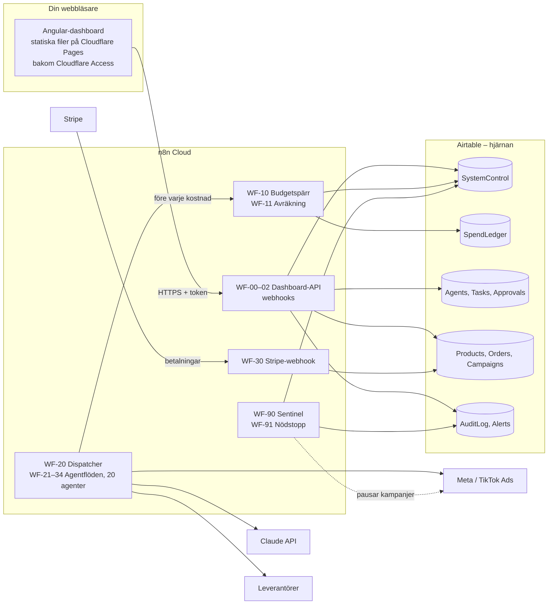
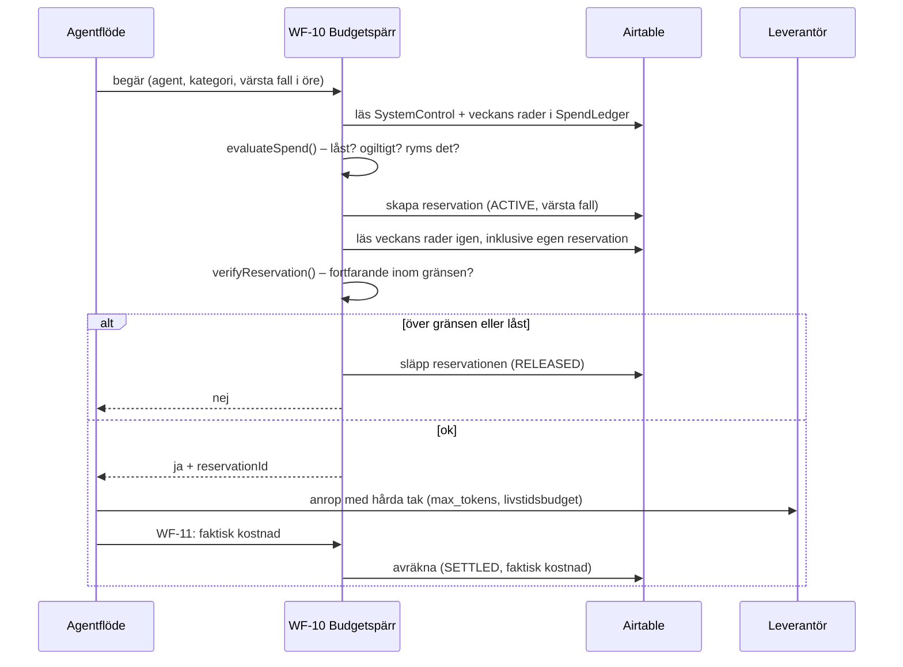

# Sentry – systemarkitektur

Sentry är ett virtuellt e-handelsbolag där 20 AI-agenter i två divisioner hittar produkter, räknar på marginaler, driver kampanjer och sköter ordrar. Du sitter vid kontrollpanelen. Agenterna föreslår, och ingenting som kostar pengar startar förrän du har godkänt det och huvudbrytaren är aktiverad.

Det här dokumentet beskriver hur delarna hänger ihop, var pengar kan uppstå och hur spärrarna gör att veckogränsen inte går att överskrida. Datamodellen finns i [DATA-MODEL.md](DATA-MODEL.md).

> **Läget i repot just nu:** Angular-dashboarden och den rena domänlogiken (budgetspärr, marginaler, ISO-veckor) är byggda och testade. Dashboarden kör mot en simulering i webbläsaren som använder samma budgetspärr. n8n-flödena och Airtable-basen är specificerade men inte byggda än. Exakt vad som ska göras, steg för steg, står i [SETUP.md](SETUP.md).

## Tre regler som allt annat följer

1. **Pengar kan bara uppstå i n8n, och bara genom budgetspärren.** Dashboarden kan inte spendera något själv. Den kan bara be n8n om saker.
2. **Lätt att stoppa, svårt att starta.** Att låsa systemet kräver ett klick, var du än är. Att aktivera kräver två avsiktliga steg och en godkänd förkontroll.
3. **Vid minsta tvivel är systemet låst.** Okänt läge, otillgänglig Airtable, felformaterade belopp eller ett flöde som kraschar leder alltid till nej (fail-closed).

## Översikt



| Del | Ansvar | Kostnad |
| --- | --- | --- |
| **Angular-dashboard** | Visar läget, tar emot dina beslut (huvudbrytare, godkännanden). Inga hemligheter i koden. | Statisk hosting, gratisnivå räcker. |
| **n8n Cloud** | All logik: agentflöden, budgetspärr, Stripe-webhooks, API:t som dashboarden pratar med, Sentinel. Körs även när din dator är avstängd. | Fast månadsplan med ett tak för antal körningar. |
| **Airtable** | Systemets minne: läge, budgetbok (ledger), agenter, uppgifter, produkter, ordrar, beslut och audit-logg. | Fast månadsplan med ett tak för API-anrop. |
| **Claude API, annonsplattformar, leverantörer** | Det som faktiskt kostar rörliga pengar. Nås bara från n8n, och bara efter budgetspärren. | Rörligt, styrs av veckogränsen. |
| **Stripe** | Tar betalt av kunderna. Inkommande betalningar registreras alltid, även i låst läge, eftersom de inte kostar något och bokföringen måste stämma. | Avgift per köp, ingår i täckningsbidraget. |

Dashboarden pratar bara med n8n, aldrig direkt med Airtable eller Claude. Airtable-token och API-nycklar ligger som credentials i n8n och lämnar aldrig n8n.

## Säkerhet i tre lager

Ett enda lager är aldrig nog när det gäller pengar. Vart och ett av de här lagren ska ensamt stoppa en kostnad som inte är tillåten.

| Lager | Var | Vad det skyddar mot |
| --- | --- | --- |
| **1. Kontrollpanelen** | Angular | Felklick och missförstånd. Visar bara läget som n8n har bekräftat, och en inaktuell bild visas som okänt läge. Aktivering är dold bakom ett skydd. Panelen är inte en säkerhetsgräns, den är ett instrument. |
| **2. Budgetspärren** | n8n (WF-10/11) | Att någon agent, något flöde eller någon samtidighet förbrukar mer än veckogränsen. Deterministisk kod, ingen AI fattar beslut om budgeten. |
| **3. Tak hos leverantörerna** | Claude Console, annonskonton | Buggar i lager 1–2. Använd förbetalda krediter utan automatisk påfyllning och de utgiftsgränser som respektive leverantör erbjuder. Annonskampanjer körs alltid med livstidsbudget. |

Lager 3 är det enda som är absolut: pengar som inte finns på kontot kan inte förbrukas. Ladda därför aldrig in mer krediter än vad du är beredd att förbruka på en vecka.

### Huvudbrytaren

Läget ligger i tabellen `SystemControl` i Airtable, som två tidsstämplar i stället för ett enda fält:

- `armedAt`: när systemet senast aktiverades.
- `lockedAt`: när systemet senast låstes.
- Effektivt läge: **ARMED** endast om `armedAt` är senare än `lockedAt`. Annars **LOCKED**.

Upplägget gör att en låsning alltid vinner. Aktivering och låsning skriver till olika fält, så de kan aldrig skriva över varandra, och vid lika tid gäller låst.

**Aktivera (ARM)** kräver att:

- klienten skickar med `expectedRevision`, alltså vilken version av läget beslutet bygger på. Har läget ändrats sedan dess, till exempel för att Sentinel har låst, avvisas aktiveringen med 409.
- n8n själv kontrollerar att veckobudgeten inte är slut och att Sentinel inte har något kritiskt larm.
- du i panelen först lyfter skyddet, som fälls ned av sig självt efter 12 sekunder, och sedan aktiverar. En anledning sparas i loggen.

**Låsa (LOCK)** har inga villkor och accepteras alltid. Panelen försöker igen automatiskt vid nätverksfel och varnar tydligt om låsningen inte kan bekräftas. En låsning:

1. sätter `lockedAt`, så att budgetspärren nekar allt nytt från och med nästa anrop.
2. startar WF-91 Nödstopp, som pausar alla aktiva kampanjer och avräknar deras reservationer till det som faktiskt förbrukats. Resten går tillbaka till budgeten.
3. låter anrop som redan pågår bli klara. De ryms redan inom sina reservationer, och att avbryta dem sparar inga pengar.

Du kan också låsa direkt i Airtable, till exempel från mobilappen, om dashboarden inte går att nå. Sentinel kontrollerar regelbundet att ett låst system inte har några aktiva kampanjer, oavsett var låsningen gjordes.

Systemet startar alltid låst.

### Budgetspärren

Varje handling som kan kosta pengar går igenom samma protokoll. Logiken finns i [`src/app/core/domain/budget-gate.ts`](../src/app/core/domain/budget-gate.ts), som är ramverksfri och testad, och ska köras i en Code-nod i n8n.



**Värsta fall räknas ut innan anropet görs, aldrig efteråt:**

| Kategori | Reservation |
| --- | --- |
| AI-anrop | Exakt antal prompt-tokens (från Claudes token counting-endpoint) × inpris × 1,25 (som om allt skrevs till prompt-cachen) + `max_tokens` × utpris. API:t tillåter aldrig fler utdata-tokens än `max_tokens`, tänkande inräknat, så taket håller. |
| Annonser | Kampanjens hela livstidsbudget reserveras i samma ögonblick som du godkänner den. Annonsplattformen kan inte gå över en livstidsbudget. |
| Betalda API-anrop | Fast pris per anrop. |
| Serververktyg | Webbsökning och liknande verktyg debiteras per användning. Begränsa med `max_uses` och räkna in det högsta antalet i reservationen. |

Allt räknas i heltal öre och avrundas uppåt. Dollarpriser räknas om med en medvetet hög växelkurs (`fxSekPerUsd` i Airtable), så att en svag krona aldrig gör reservationen för liten.

**En reservation per agentkörning.** En körning reserverar summan av sina värsta fall på en gång och avräknar en gång. Det håller veckans budgetbok på några hundra rader, så att varje kontroll i spärren blir få Airtable-anrop.

**Varför samtidiga agenter inte kan spräcka gränsen:** Airtable har inga transaktioner, så spärren låser ingenting. Den skriver i stället sin reservation först och kontrollerar sedan summan inklusive den egna raden. Av alla förfrågningar som får ja är den som verifierades sist garanterat den som såg alla andras reservationer. Därför kan summan av allt som får ja aldrig passera gränsen. I värsta fall nekas två förfrågningar som tillsammans hade fått plats, vilket är rätt håll att fela åt. Testet [`budget-gate.spec.ts`](../src/app/core/domain/budget-gate.spec.ts) går igenom alla möjliga sätt som tre samtidiga förfrågningar kan flätas ihop på och visar att gränsen håller i varje fall. Förutsättningen är att en läsning i Airtable ser skrivningar som redan har bekräftats. Spärren kontrollerar det själv vid varje förfrågan: syns inte den egna, nyss skapade raden blir svaret nej. Lager 3 finns för den dag något antagande inte håller.

**Avräkning:** Den faktiska kostnaden ersätter reservationen. Den kan per konstruktion inte bli högre än reservationen. Blir den ändå det, till exempel för att en token-räkning var fel, låser Sentinel systemet direkt och slår larm.

**Veckan:** Varje rad i budgetboken bär sin ISO-vecka (`2026-W44`) räknad i Europe/Stockholm, så att veckan alltid börjar måndag 00:00 svensk tid, även när sommartiden slutar. Inget behöver nollställas: en ny vecka har helt enkelt inga rader än.

**Höja gränsen:** Det görs bara i Airtable, där det krävs att du är inloggad med ditt eget konto, helst med tvåstegsverifiering. Dashboardens token räcker inte för att höja gränsen. Om den läcker kan den aktivera systemet, men aldrig för mer än veckans gräns.

### Godkännanden

Agenterna lägger förslag i tabellen `Approvals`, till exempel nya produkter och kampanjer. Ingenting startar förrän förslaget har godkänts i panelen. Ett förslag som kostar pengar, som en kampanj, kräver dessutom att systemet är aktiverat, och dess budget reserveras genom budgetspärren i samma ögonblick som du godkänner.

### Sentinel

SENTINEL (T2-10) är två saker:

- **Deterministiska regler i WF-90**, som körs i början av varje dispatcheromgång och dessutom en gång per dygn: varningsnivå nådd (80 %), budgeten slut, kostnad över reservation, reservationer som hängt kvar för länge och kampanjer som körs i låst läge. Reglerna får **låsa** systemet men aldrig aktivera det.
- **En agent** som sammanfattar avvikelser för dig. Den har ingen makt över budgeten.

### Åtkomst och hemligheter

- **Cloudflare Access** framför dashboarden, så att bara din e-post eller inloggning kommer åt sidan.
- **n8n-webhookarna** skyddas med en Header Auth-credential (`Authorization: Bearer …`). Under *Allowed Origins (CORS)* anges bara dashboardens domän. Headern gör att webbläsaren skickar en preflight, och [SETUP.md](SETUP.md#koppla-dashboarden) har ett test för den. Klarar n8n den inte läggs en proxy i Cloudflare Pages Functions, så att dashboard och API hamnar på samma domän och token aldrig behöver finnas i webbläsaren.
- **Operatörstoken** skrivs in vid anslutning och sparas i `sessionStorage`, så den försvinner när fliken stängs. Den skickas bara till n8n-adressen, vilket kontrolleras mot origin och sökväg ([`operator-token.interceptor.ts`](../src/app/core/api/operator-token.interceptor.ts)).
- **Airtable-token** finns bara i n8n, med åtkomst till en enda bas och bara de behörigheter som behövs.
- **Säkerhetsheaders** ([`public/_headers`](../public/_headers)): strikt CSP, inga externa skript och `frame-ancestors 'none'` så att ingen kan bädda in panelen och lura fram ett klick på aktivera.
- **Ingen SSR och ingen egen server.** Byggresultatet är statiska filer.

## n8n-arbetsflöden

| Flöde | Startas av | Gör |
| --- | --- | --- |
| **WF-00 Dashboard-API** | Webhook `GET /snapshot` | Läser tabellerna, räknar ihop veckan med samma formler som `core/domain` och svarar med en snapshot. |
| **WF-01 Huvudbrytare** | Webhook `POST /control` | Validerar, sätter `armedAt`/`lockedAt`, loggar och startar WF-91 vid låsning. |
| **WF-02 Beslut** | Webhook `POST /approvals/decision` | Godkänner eller avvisar. Kampanjer reserveras via WF-10. |
| **WF-10 Budgetspärr** | Sub-workflow, från alla flöden som kostar | Protokollet ovan. Svarar ja/nej + `reservationId`. |
| **WF-11 Avräkning** | Sub-workflow | Bokför faktisk kostnad och tokens och låser via WF-12 om reservationen överskreds. |
| **WF-12 Lås** | Sub-workflow, från WF-01, WF-11 och Sentinel | Den enda implementationen av en låsning: `lockedAt`, logg och WF-91. |
| **WF-14 Veckogräns** | Schema måndagar 00:05 | Föreslår en högre veckogräns utifrån realiserad vinst (godkänns av dig), eller sänker den efter en förlustvecka. |
| **WF-20 Dispatcher** | Schema var 30:e minut, bara aktiv när systemet är aktiverat | Kör Sentinel och startar sedan de agenter som står på tur, en i taget, som sub-workflows. |
| **WF-21–24** Division I | Sub-workflow från dispatchern | Produktpipeline, försäljning och leads, order och kundservice, intäktsavstämning. |
| **WF-31–34** Division II | Sub-workflow från dispatchern | Strategi och trender, kampanjmotor, innehåll och SEO, konvertering och digitala produkter. |
| **WF-30 Stripe-webhook** | Stripe Trigger | Signaturkontroll, order in i `Orders`, avgiften hämtas från Stripes balance transaction. |
| **WF-90 Sentinel** | Sub-workflow från dispatchern + schema en gång per dygn | Reglerna ovan. |
| **WF-91 Nödstopp** | WF-12 | Inaktiverar dispatchern, pausar kampanjer, avräknar annonsreservationer och loggar. |
| **WF-99 Fel** | Error Trigger | Felflöde för alla andra flöden: kritisk logg och larm. |

Agenterna har inga egna scheman. All agentaktivitet startas av dispatchern, och den är bara aktiv när systemet är aktiverat: WF-01 slår på den vid aktivering och WF-91 slår av den vid låsning. Det är en andra, oberoende spärr bredvid budgetspärren, och den gör att ett låst system inte förbrukar några n8n-körningar alls. Sub-workflows räknas inte mot n8n:s kvot, så en hel omgång med flera agenter är en enda körning.

Agenterna anropar aldrig varandra. En agent skriver sitt resultat som en rad i `Tasks`, och nästa agent plockar upp raden därifrån i en senare omgång. Det är de överlämningarna som syns i panelen.

**Anrop till Claude** görs med HTTP Request-noden mot `https://api.anthropic.com/v1/messages`, med headern `anthropic-version: 2026-10-21`. Den versionen svarar 400 på `temperature`, `top_p` och `top_k`, så de skickas aldrig. Varje anrop har ett `max_tokens`, och svaret styrs till JSON med `output_config.format`. Exakt antal prompt-tokens hämtas med `POST /v1/messages/count_tokens` före anropet.

## API mellan dashboard och n8n

Alla svar valideras med zod-scheman ([`model.ts`](../src/app/core/domain/model.ts)) innan dashboarden använder dem. Huvudbrytarens läge, budgeten och ekonomin måste vara giltiga, annars avvisas hela svaret. En trasig rad i en lista, till exempel en order, sorteras bort och visas som en varning, så att resten av panelen fortfarande fungerar.

| Anrop | Kropp | Svar |
| --- | --- | --- |
| `GET {bas}/snapshot` | – | `DashboardSnapshot` |
| `POST {bas}/control` | `{ action: 'ARM' \| 'LOCK', expectedRevision?, reason }` | `{ control: ControlState }` |
| `POST {bas}/approvals/decision` | `{ approvalId, decision: 'APPROVE' \| 'REJECT', note? }` | `{ result: ApprovalDecisionResult }` |

Fel svaras med HTTP-status och `{ "error": { "code": "...", "message": "..." } }`, där `message` är på svenska och visas för dig. 401 betyder fel token, 409 att läget har ändrats och 422 att begäran avvisades (till exempel att budgeten inte räcker).

**Varje anrop är en n8n-körning och ett antal Airtable-anrop**, och båda räknas mot planernas tak. Därför:

- frågar dashboarden n8n högst var 30:e sekund. Det är inbyggt i koden och gäller oavsett konfiguration. Rekommendationen är 120 sekunder. Gränsen för när data räknas som inaktuell följer automatiskt med, så att brytaren inte blinkar till okänt läge mellan hämtningarna.
- pausas hämtningen när fliken inte syns, och väntetiden ökar vid fel (upp till 5 minuter).
- hämtar en enda snapshot allt, så det blir ingen separat förfrågan per panel. Efter varje kommando hämtas läget direkt.

Med 120 sekunders intervall och panelen öppen 4 timmar om dagen blir det cirka 3 600 körningar och 43 000 Airtable-anrop i månaden. En hel kalkyl finns i [SETUP.md](SETUP.md#kvoter-i-drift).

## Kostnadsmodell

| Typ | Exempel | Styrs av |
| --- | --- | --- |
| Fasta verktyg | n8n Cloud, Airtable, domän | Planval. Visas som veckoandel i resultatet. |
| Rörligt, budgetstyrt | AI-tokens, betalda API:er, annonser | Veckogränsen och budgetspärren. |
| Per order | Inköp, frakt, Stripe-avgift | Ingår i täckningsbidraget per order. |

**Kostnadseffektiva val som är inbyggda i upplägget:**

- **Modell per agent.** Agenter med hög volym och enkla uppgifter kör Claude Haiku 5.5. Analys och kreativt arbete kör Claude Sonnet 5.5. Bara STAR, som gör veckostrategin, kör Claude Opus 5.5. Modellen är ett fält per agent i Airtable, så du kan byta utan ny kod. Mät kvaliteten på riktiga uppgifter innan du sänker en agents modell.
- **Prompt-cache** för agenternas fasta systemprompter. Cachade tokens kostar en bråkdel av vanliga.
- **Batch API** (halva priset) för nattliga skanningar som inte brådskar, till exempel SCOUT, ATLAS, RECON och PULSE.
- **Snäva `max_tokens`** per uppgiftstyp. Det sänker både kostnaden och reservationen, så att mer ryms i veckan.
- **Annonser** är i praktiken den största rörliga kostnaden. AI-anropen kostar i regel ören till några kronor styck.

Priser (USD per miljon tokens, hämtade 2026-10-06, finns i [`pricing.ts`](../src/app/core/domain/pricing.ts) och ska i drift ligga i tabellen `ModelPricing`):

| Modell | In | Ut |
| --- | --- | --- |
| Claude Haiku 5.5 | 0,10 (0,50 över 100k prompt-tokens) | 0,50 (2,50 över 100k) |
| Claude Sonnet 5.5 | 2,00 | 10,00 |
| Claude Opus 5.5 | 4,00 | 20,00 |

Verktygsbeloppen i simuleringen är exempel. Lägg in dina faktiska planer i tabellen `ToolCosts`.

## De 20 agenterna

| Id | Kodnamn | Roll | Modell | Flöde |
| --- | --- | --- | --- | --- |
| **Division I: Vanguard** | | *E-handel och fysiska produkter* | | |
| T1-01 | SCOUT | Produktforskning | Haiku 5.5 | WF-21 Produktpipeline |
| T1-02 | ATLAS | Marknadsanalys | Sonnet 5.5 | WF-21 Produktpipeline |
| T1-03 | RECON | Konkurrentanalys | Haiku 5.5 | WF-21 Produktpipeline |
| T1-04 | HARBOR | Leverantörer och inköp | Haiku 5.5 | WF-21 Produktpipeline |
| T1-05 | VOID | Prissättning och marginal | Sonnet 5.5 | WF-21 Produktpipeline |
| T1-06 | MAGNET | Leadhantering | Haiku 5.5 | WF-22 Försäljning och leads |
| T1-07 | CONDUIT | Säljpipeline | Sonnet 5.5 | WF-22 Försäljning och leads |
| T1-08 | COURIER | Order och leverans | Haiku 5.5 | WF-23 Order och kundservice |
| T1-09 | HAVEN | Kundservice och återköp | Haiku 5.5 | WF-23 Order och kundservice |
| T1-10 | LEDGER | Intäktsoperationer | Sonnet 5.5 | WF-24 Intäktsavstämning |
| **Division II: Meridian** | | *Digitala produkter, strategi och optimering* | | |
| T2-01 | STAR | Affärsstrategi | Opus 5.5 | WF-31 Strategi och trender |
| T2-02 | PULSE | Trendanalys | Haiku 5.5 | WF-31 Strategi och trender |
| T2-03 | PRISM | Målgruppsanalys | Sonnet 5.5 | WF-31 Strategi och trender |
| T2-04 | MUSE | Annonskreativ | Sonnet 5.5 | WF-32 Kampanjmotor |
| T2-05 | VECTOR | Kampanjledning | Sonnet 5.5 | WF-32 Kampanjmotor |
| T2-06 | QUILL | Innehållsproduktion | Sonnet 5.5 | WF-33 Innehåll och SEO |
| T2-07 | CATALYST | Konverteringsoptimering | Sonnet 5.5 | WF-34 Konvertering och digitala produkter |
| T2-08 | BEACON | SEO och organisk synlighet | Haiku 5.5 | WF-33 Innehåll och SEO |
| T2-09 | FOUNDRY | Digital produktutveckling | Sonnet 5.5 | WF-34 Konvertering och digitala produkter |
| T2-10 | SENTINEL | Risk- och prestandakontroll | Sonnet 5.5 | WF-90 Sentinel |

## Kodstruktur

```
src/app/
├── core/
│   ├── domain/          Ramverksfri logik och datakontrakt – kan flyttas till n8n Code-noder
│   │   ├── model.ts             zod-scheman för hela kontraktet; typerna härleds ur dem
│   │   ├── budget-gate.ts       budgetspärren: evaluateSpend, verifyReservation, ledgerTotals
│   │   ├── order-economics.ts   moms, täckningsbidrag och marginal per order
│   │   ├── pricing.ts           modellpriser och värsta-fall-kostnad per anrop
│   │   ├── iso-week.ts          ISO-veckor i Europe/Stockholm
│   │   └── money.ts             heltal öre
│   ├── api/             Dörren till backend
│   │   ├── sentry-api.ts            abstrakt port som mock och n8n delar
│   │   ├── n8n-sentry-api.ts        HTTP mot n8n-webhookar, med validering
│   │   ├── snapshot-parser.ts       strikt för kritiska delar, tolerant för listor
│   │   ├── operator-session.ts      token i sessionStorage
│   │   └── operator-token.interceptor.ts
│   ├── mock/            Simulering av n8n + Airtable med samma budgetspärr
│   └── state/
│       └── sentry-store.ts      signals + RxJS: snapshot, polling, kommandon
├── features/
│   ├── control/         Huvudbrytaren
│   ├── budget/          Veckobudget och mätare
│   ├── approvals/       Förslag som väntar på ditt beslut
│   ├── finance/         Nyckeltal, ordrar, resultat och kostnader
│   ├── agents/          Organisationsschemat, agentkort och överlämningarna
│   ├── audit/           Loggen
│   ├── shell/           Ramen: toppfält, sidomeny, huvudbrytaren och anslutning till n8n
│   └── pages/           En sida per menyval: Översikt, Agenter, Produktförslag, Ordrar,
│                        Ekonomi och budget, Logg
└── shared/              Formatering (svenska), pipes, etiketter, ikoner, sparkline
```

## Från simulering till drift

Hela vägen, med varje flöde nod för nod, acceptanstester och kvotkalkyl, står i [SETUP.md](SETUP.md). I korthet:

1. Sätt taken hos leverantörerna (lager 3).
2. Bygg Airtable-basen enligt [DATA-MODEL.md](DATA-MODEL.md).
3. Bygg WF-10 och WF-11 först och testa dem innan något annat flöde får röra pengar.
4. Bygg WF-12, WF-01, WF-91 och WF-20, sedan WF-00 och WF-02. Låt WF-00 svara med samma form som simuleringen.
5. Koppla dashboarden: `mode: 'n8n'`, `n8nBaseUrl` och `pollIntervalMs: 120_000` i `src/environments/environment.ts`, och testa CORS-preflighten.
6. Koppla in agenterna en i taget, med SENTINEL först.

## Nästa steg

- n8n-flödena ovan som importerbara JSON-filer, med början i budgetspärren.
- Airtable-basen, skapad med ett skript via Airtables Meta API utifrån DATA-MODEL.md.
- Om CORS-testet inte går igenom: en proxy i Cloudflare Pages Functions framför n8n.
- En inställningsvy där veckogränsen kan *sänkas* från panelen (höjning sker bara i Airtable).
- Egna sidor för loggen (sök och export) och för varje agent.
