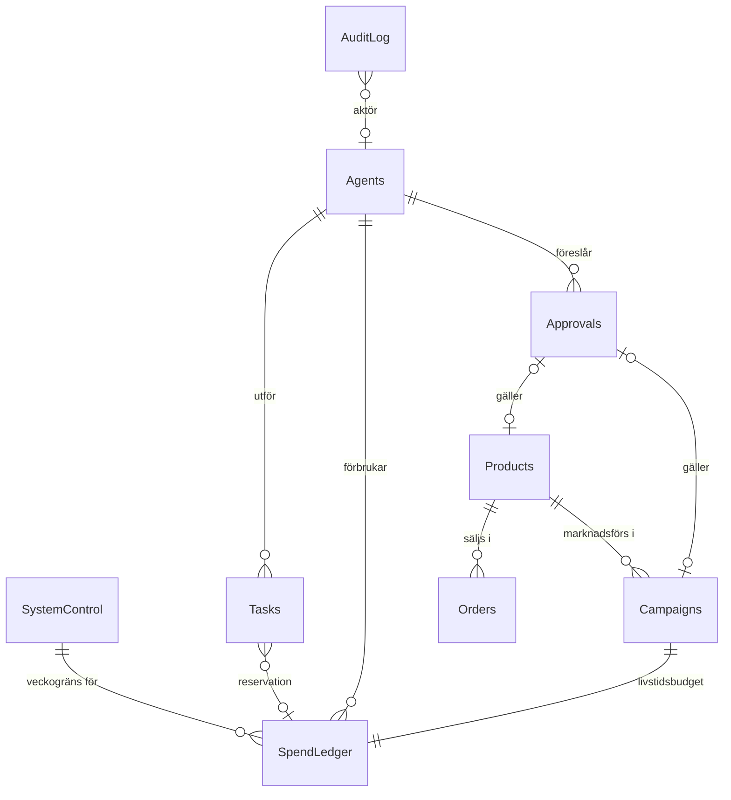

# Sentry – datamodell

Airtable är Sentrys minne. Här beskrivs tabellerna i basen och kontraktet som n8n svarar dashboarden med. Kontraktet är definierat i kod, som zod-scheman i [`src/app/core/domain/model.ts`](../src/app/core/domain/model.ts). Det är den filen som gäller om det här dokumentet och koden någon gång skiljer sig åt.

## Konventioner

- **Pengar är alltid heltal öre** (`…Ore`). 499 kr lagras som `49900`. I Airtable används fälttypen Number med 0 decimaler. Flyttal används aldrig i en budgetjämförelse.
- **Andelar är baspunkter** (`…Bp`). 25 % moms är `2500` och 38,6 % marginal är `3860`.
- **Tider är ISO 8601 i UTC** i API:t. Airtable-fält av typen Date med tid ställs in på GMT.
- **Veckor är ISO-veckor i Europe/Stockholm**, i formatet `2026-W44`, med måndag 00:00 svensk tid som start.
- **Uppräkningar** skrivs med versaler (`ARMED`, `AI_TOKENS`) och är Single select i Airtable.
- **Budgetboken och loggen är append-only.** Rader läggs till och får byta status, men raderas aldrig.
- **Inga beräknade fält krävs.** Formel-, rollup- och autonummerfält behövs inte, eftersom n8n räknar fram läge och summor själv och postens record-id (`rec…`) fungerar som id. Hela basen kan därför skapas med ett skript.
- **Nycklar mellan tabeller lagras som text** (`agentId`, `productId`, `taskId`), så att n8n kan filtrera utan extra uppslag. Länkfält får läggas till för att det ska bli bekvämare i Airtable, men flödena är inte beroende av dem.

## Relationer

## Tabeller

### SystemControl

Exakt en rad. Huvudbrytaren och veckogränsen.

| Fält | Typ | Beskrivning |
| --- | --- | --- |
| `armedAt` | Date/time | Senaste aktivering. Tom om systemet aldrig har aktiverats. |
| `lockedAt` | Date/time | Senaste låsning. Sätts vid första uppstart. |
| `state` | Formula (valfri) | `IF(AND({armedAt}, IS_AFTER({armedAt}, {lockedAt})), "ARMED", "LOCKED")`. Bara för visning i Airtable, eftersom n8n alltid räknar fram läget själv på samma sätt. Låst vinner vid lika tid och när något fält saknas. |
| `revision` | Number | Ökas med 1 vid varje ändring. En aktivering måste ange den revision den bygger på. |
| `changedByKind` | Single select | `OPERATOR`, `SENTINEL`, `SYSTEM`, `WORKFLOW` |
| `changedBy` | Single line text | Id, till exempel `operator` eller `T2-10`. |
| `reason` | Long text | Anledningen som angavs. |
| `weeklyLimitOre` | Number | Den hårda veckogränsen. Höjs bara av WF-02 när du godkänner ett budgetförslag, eller av dig direkt här. Sänks av WF-14 efter en förlustvecka. Dashboarden skickar aldrig något belopp, bara id:t på förslaget du godkänner. |
| `baseLimitOre` | Number | Golvet som gränsen sänks tillbaka mot efter förluster, till exempel `150000`. |
| `limitCeilingOre` | Number | Taket. Inget förslag får gå över det, och WF-02 kontrollerar det igen vid godkännandet. Till exempel `500000`. |
| `profitShareBp` | Number | Hur stor del av vinsten som läggs på gränsen, till exempel `5000` (50 %). |
| `settleDays` | Number | Dagar innan en orders vinst räknas som realiserad, `14` (ångerrätten). |
| `warnAtBp` | Number | När Sentinel varnar, till exempel `8000` (80 %). |
| `fxSekPerUsd` | Number (2 dec.) | Medvetet hög växelkurs för omräkning av dollarpriser. |

### SpendLedger

Budgetboken. En rad per sak som får kosta pengar.

| Fält | Typ | Beskrivning |
| --- | --- | --- |
| *(record-id)* | – | Reservationens id, `reservationId` i flödena. |
| `requestId` | Single line text | Unikt per förfrågan. Ett omförsök med samma värde skapar ingen ny reservation. |
| `weekId` | Single line text | `2026-W44`, satt när raden skapas. |
| `agentId` | Single line text | Vem som begärde, till exempel `T1-01`. |
| `taskId` | Single line text | Uppgiften som kostar, om någon. |
| `category` | Single select | `AI_TOKENS`, `API_CALLS`, `ADS` |
| `status` | Single select | `ACTIVE` (reserverad), `SETTLED` (avräknad), `RELEASED` (släppt utan kostnad) |
| `reservedOre` | Number | Värsta fallet, satt före anropet. Ändras aldrig. |
| `actualOre` | Number | Faktisk kostnad. För en pågående kampanj: förbrukat hittills. |
| `model` | Single line text | Till exempel `claude-sonnet-5-5`. |
| `inputTokens`, `outputTokens` | Number | Från API-svarets usage. |
| `purpose` | Single line text | Kort beskrivning. |
| `n8nExecutionId` | Single line text | Spårbarhet till körningen i n8n. |
| `createdAt` | Date/time | Sätts av n8n. |
| `settledAt` | Date/time | |

Veckans förbrukning räknas så här (`ledgerTotals` i koden):

- **förbrukat** = summan av `actualOre` på `SETTLED`- och `ACTIVE`-rader
- **reserverat** = summan av `max(0, reservedOre − actualOre)` på `ACTIVE`-rader
- **kvar** = `weeklyLimitOre − förbrukat − reserverat`. Får aldrig bli negativt.

Räkna alltid summorna i n8n genom att lista raderna. Använd inte rollup-fält, eftersom de kan uppdateras med fördröjning.

### Agents

| Fält | Typ | Beskrivning |
| --- | --- | --- |
| `agentId` | Single line text | `T1-01` … `T2-10` |
| `codename` | Single line text | `SCOUT`, `SENTINEL` … |
| `role` | Single line text | Till exempel Produktforskning. |
| `division` | Single select | `VANGUARD`, `MERIDIAN` |
| `rank` | Single select | `CHIEF` (divisionschef), `WORKER`, `OVERSIGHT` (Sentinel). Tomt räknas som `WORKER`. |
| `team` | Single line text | Teamet under chefen, till exempel `Marknad`. Styr grupperingen i organisationsschemat. |
| `reportsTo` | Single line text | `agentId` för chefen. Tomt = rapporterar direkt till dig. |
| `model` | Single select | `claude-haiku-5-5`, `claude-sonnet-5-5`, `claude-opus-5-5` |
| `workflow` | Single line text | Namnet på n8n-flödet som kör agenten. |
| `workflowId` | Single line text | Flödets id i n8n. Dispatchern startar agenten med det. |
| `enabled` | Checkbox | Av = agenten startas aldrig och visas som pausad. |
| `cadenceMinutes` | Number | Hur ofta dispatchern ska starta agenten. Tomt = bara vid överlämning. |
| `nextRunAt` | Date/time | Nästa gång agenten står på tur. |
| `systemPrompt` | Long text | Agentens uppdrag. |
| `maxOutputTokens` | Number | Taket per anrop, ingår i värsta fallet. |
| `effort` | Single select | `low`, `medium`, `high` |
| `webSearchMaxUses` | Number | 0 = ingen webbsökning. |
| `config` | Long text | JSON med agentens inställningar, till exempel kategorier och sökord. |
| `status` | Single select | `IDLE`, `WORKING`, `AWAITING_APPROVAL`, `BLOCKED_BUDGET`, `PAUSED`, `ERROR` |
| `currentTaskId` | Single line text | |
| `lastActiveAt` | Date/time | |

Veckans kostnad och antal uppgifter per agent räknas fram ur `SpendLedger` och lagras inte.

Hierarkin i dashboarden: VOID (`T1-05`) leder Vanguard och STAR (`T2-01`) leder Meridian, eftersom de redan tar emot sina divisioners resultat. Sentinel (`T2-10`) har `rank` = `OVERSIGHT` och tomt `reportsTo`, så tillsynen står utanför båda cheferna. Teamen:

| Division | Team | Agenter |
| --- | --- | --- |
| Vanguard | Marknad | SCOUT, ATLAS, RECON |
| Vanguard | Inköp och försäljning | HARBOR, MAGNET, CONDUIT |
| Vanguard | Order och intäkter | COURIER, HAVEN, LEDGER |
| Meridian | Insikt | PULSE, PRISM |
| Meridian | Kampanj och innehåll | MUSE, VECTOR, QUILL |
| Meridian | Tillväxt och produkt | CATALYST, BEACON, FOUNDRY |

Hierarkin är bara organisation och visning. Budgetspärren behandlar alla agenter lika, och en chef kan aldrig godkänna kostnader i ditt ställe.

### Tasks

Uppgifter och överlämningar. En agent kommunicerar genom att skapa en rad här till en annan agent.

| Fält | Typ | Beskrivning |
| --- | --- | --- |
| *(record-id)* | – | Uppgiftens id, `taskId` i flödena. |
| `title` | Single line text | |
| `agentId` | Single line text | Den som utför. |
| `fromAgentId` | Single line text | Den som lämnade över. Tom om uppgiften kom från ett schema. |
| `status` | Single select | `QUEUED`, `RUNNING`, `DONE`, `FAILED`, `DENIED`, `CANCELLED` |
| `claimedBy` | Single line text | Id för n8n-körningen som tagit uppgiften, så att två omgångar inte gör samma jobb. |
| `reservationId` | Single line text | |
| `costOre` | Number | Kopierad från avräkningen. |
| `input`, `output` | Long text | JSON. |
| `workflow` | Single line text | |
| `createdAt`, `startedAt`, `finishedAt` | Date/time | |

### Approvals

| Fält | Typ | Beskrivning |
| --- | --- | --- |
| *(record-id)* | – | Förslagets id, `approvalId` i API:t. |
| `kind` | Single select | `PRODUCT_LAUNCH`, `CAMPAIGN_LAUNCH`, `BUDGET_LIMIT` |
| `title`, `summary` | Text | |
| `requestedBy` | Single line text | Agentens id. |
| `costOre` | Number | Det som reserveras vid godkännande. `0` = ingen direkt kostnad. |
| `expectedMarginBp` | Number | Beräknad marginal, om det är en produkt. |
| `proposedLimitOre` | Number | Bara för `BUDGET_LIMIT`: den nya veckogränsen som gäller när du godkänner. |
| `productId` / `campaignId` | Single line text | Det förslaget gäller. |
| `payload` | Long text | JSON med det som skapas vid godkännande, till exempel kampanjens inställningar. |
| `status` | Single select | `PENDING`, `APPROVED`, `REJECTED`, `EXPIRED` |
| `decidedAt`, `decisionNote` | Date/time, text | |

### Products

| Fält | Typ | Beskrivning |
| --- | --- | --- |
| `productId` | Single line text | |
| `title` | Single line text | |
| `kind` | Single select | `PHYSICAL`, `DIGITAL` |
| `status` | Single select | `PROPOSED`, `LIVE`, `PAUSED`, `RETIRED`, `REJECTED` |
| `priceOre` | Number | Pris inklusive moms. |
| `vatRateBp` | Number | `2500` för de flesta varor, `600` för e-böcker. |
| `cogsOre` | Number | Inköpspris från leverantör. |
| `shippingOre` | Number | Frakt per order. |
| `supplier` | Single line text | |
| `proposedBy` | Single line text | Agentens id. |
| `paymentLink` | URL | Stripe-betallänken, skapas när produkten godkänns. |

### Orders

Skrivs av WF-30 från Stripe. Täckningsbidrag och marginal lagras inte, de räknas fram ur fälten nedan (`orderEconomics` i koden).

| Fält | Typ | Beskrivning |
| --- | --- | --- |
| `orderId` | Single line text | |
| `stripeRef` | Single line text | PaymentIntent-id. |
| `createdAt` | Date/time | |
| `productId` | Single line text | |
| `quantity` | Number | |
| `grossOre` | Number | Vad kunden betalade, inklusive moms. |
| `vatRateBp` | Number | |
| `refundedOre` | Number | Återbetalt, inklusive moms. |
| `paymentFeeOre` | Number | Stripes avgift, från balance transaction. |
| `cogsOre`, `shippingOre` | Number | |
| `adCostOre` | Number | Annonskostnad som tillskrivs ordern (en uppskattning). |
| `status` | Single select | `PAID`, `FULFILLED`, `REFUNDED` |

Per order gäller:

- nettointäkt = (`grossOre` − `refundedOre`) minus momsen i det beloppet
- täckningsbidrag = nettointäkt − `paymentFeeOre` − `cogsOre` − `shippingOre` − `adCostOre`
- marginal = täckningsbidrag ÷ nettointäkt

Vid återbetalning återfås momsen, men inte Stripes avgift, inköpet eller frakten.

Veckans resultaträkning använder den *faktiska* annonskostnaden från `SpendLedger`, inte summan av `adCostOre`.

### Campaigns

| Fält | Typ | Beskrivning |
| --- | --- | --- |
| `campaignId` | Single line text | |
| `platform` | Single select | `META`, `TIKTOK` |
| `externalId` | Single line text | Kampanjens id hos plattformen. |
| `productId` | Single line text | |
| `lifetimeBudgetOre` | Number | Hela budgeten, reserveras vid godkännande. |
| `spentOre` | Number | Synkas från plattformen. |
| `status` | Single select | `RUNNING`, `PAUSED`, `ENDED` |
| `reservationId` | Single line text | |

### ToolCosts

| Fält | Typ | Beskrivning |
| --- | --- | --- |
| `toolId`, `name`, `plan` | Text | |
| `monthlyOre` | Number | Fast månadskostnad. Veckoandelen är `monthlyOre × 12 ÷ 52`. |

### ModelPricing

| Fält | Typ | Beskrivning |
| --- | --- | --- |
| `model` | Single line text | Exakt modell-id. |
| `inputUsdPerMTok`, `outputUsdPerMTok` | Number | |
| `longContextAboveTokens`, `longContextInputUsdPerMTok`, `longContextOutputUsdPerMTok` | Number | För modeller med eget pris för långa prompter. |
| `checkedAt` | Date | När priset senast stämdes av. |

### AuditLog

Append-only. Allt som ändrar läge, pengar eller beslut loggas här.

| Fält | Typ | Beskrivning |
| --- | --- | --- |
| *(record-id)* | – | Händelsens id. |
| `at` | Date/time | Sätts av n8n. |
| `actorKind` | Single select | `OPERATOR`, `AGENT`, `SENTINEL`, `SYSTEM`, `WORKFLOW` |
| `actorId`, `actorLabel` | Text | |
| `action` | Single line text | Till exempel `MASTER_SWITCH_ARMED`, `SPEND_DENIED`, `CAMPAIGN_APPROVED`. |
| `severity` | Single select | `INFO`, `NOTICE` (beslut), `WARNING`, `CRITICAL` |
| `message` | Long text | På svenska, visas i panelen. |
| `payload` | Long text | JSON med detaljer. |
| `n8nExecutionId` | Single line text | |

### Alerts

| Fält | Typ | Beskrivning |
| --- | --- | --- |
| *(record-id)* | – | Larmets id. |
| `raisedAt` | Date/time | Sätts av n8n. |
| `severity` | Single select | `WARNING`, `CRITICAL`. Ett aktivt kritiskt larm hindrar aktivering. |
| `source` | Single line text | Till exempel `SENTINEL`. |
| `message` | Long text | |
| `resolvedAt` | Date/time | Tom = aktivt. |

## Kontraktet mot dashboarden

`GET /snapshot` svarar med ett `DashboardSnapshot`:

| Del | Innehåll | Om den är ogiltig |
| --- | --- | --- |
| `control` | Huvudbrytarens läge, revision, vem och varför | Hela svaret avvisas |
| `budget` | Vecka, gräns, förbrukat, reserverat, per kategori, tokens, anrop, nekade förfrågningar, takt per timme | Hela svaret avvisas |
| `finance` | Veckans resultaträkning och 14 dagars dagsvärden | Hela svaret avvisas |
| `costs` | Verktyg och användning per modell | Hela svaret avvisas |
| `orders` | De senaste ordrarna, nyast först | Raden sorteras bort och rapporteras |
| `agents` | Alla 20 med läge, pågående uppgift och historik | Raden sorteras bort och rapporteras |
| `handoffs` | De senaste överlämningarna | Raden sorteras bort och rapporteras |
| `approvals` | Väntande förslag | Raden sorteras bort och rapporteras |
| `audit` | De senaste händelserna | Raden sorteras bort och rapporteras |
| `alerts` | Aktiva larm | Raden sorteras bort och rapporteras |

Simuleringen producerar exakt det här formatet, och [`simulation.spec.ts`](../src/app/core/mock/simulation.spec.ts) kontrollerar det mot schemat. Ett svar från WF-00 som klarar samma kontroll fungerar direkt i panelen.
